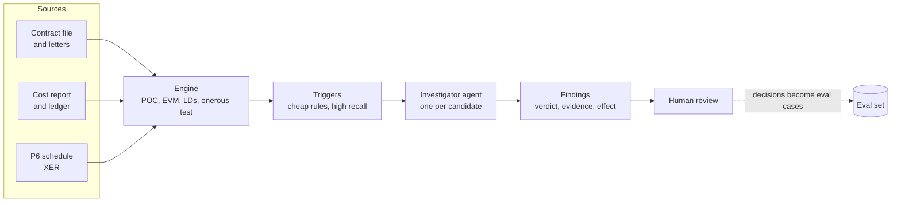

# Second Source

**Challenges the accounting on long-term fixed-price contracts by testing management's numbers against evidence finance doesn't control: the project schedule, the contract file and the customer's correspondence.**

For each contract it answers one question before the close: *is the reported margin supported by the evidence, and if not, by how much and what should we ask?* Every judgement gets one of four verdicts, every number comes from a deterministic engine, and every finding cites the document it rests on.

> **Status:** working prototype. The engine, triggers, rule baseline, eval harness, agent loop and MCP server run today on a 20-contract portfolio. The headline result (agent vs one-prompt baseline) is next.

## Why

Long-term contract accounting fails in its inputs, not its arithmetic. Revenue is a share of the transaction price (TP), measured by cost progress, so nearly every misstatement either inflates TP (unagreed variations, optimistic claims) or deflates the estimated cost to complete (ETC). Those judgements are usually tested against management's own story. The evidence that contradicts them lives in other systems, chiefly the P6 schedule and customer correspondence.

When those judgements go wrong, the result is restatements, regulatory fines and, in the worst cases, corporate collapse.

## How it works



- **Engine** (`engine.py`): every number. POC, revenue, the onerous test, earned value, LDs, scenario re-runs.
- **Triggers** (`triggers.py`): raise candidate issues per check. A candidate is a question worth asking, not a finding.
- **Investigator** (`agent/`): one short-lived sub-agent per candidate, with tools to read and search documents, query the engine and run scenarios. It never supplies numbers: it proposes input overrides and the engine computes the effect. Quotes are verified against the cited document.
- **MCP server** (`mcp_server.py`): the read and scenario tools, so a controller can question a contract from Claude.

### Checks in v0

| ID | Question | Evidence it needs |
|---|---|---|
| T1 | Is each variation in TP agreed by the customer, or enforceable? (IFRS 15.18-21) | Variation register vs customer letters |
| E2 | Is management's ETC credible against earned value and physical progress? | P6 schedule, cost report, review minutes |
| M1 | If management's own EAC exceeds TP, is the full loss provided for? (IAS 37.66-69) | Engine output |

### Verdicts

| Verdict | Meaning | Output |
|---|---|---|
| supported | Evidence backs the treatment | Evidence links |
| misstated | Evidence shows it's wrong | Engine-computed correction |
| judgement_call | Evidence supports a range | Range and a question for a named role |
| insufficient_evidence | Can't tell from the file | The document that would settle it |

## Ground truth: a portfolio you can read and edit

Real contract files are confidential, so the evals run on synthetic ones, committed as plain files in [`portfolios/hard/`](portfolios/hard/INDEX.md): 20 fixed-price contracts of about 130k tokens each. Each has terms, a cost report with its variation register and ETC build-up, a cost-loaded P6 programme of a few hundred activities, a ledger, and 60–80 documents: the contract, daily site diaries, monthly progress minutes, internal cost reviews, correspondence and RFI registers, and dozens of letters and emails. Each contract has an answer key, kept where no system can read it, giving the verdict and corrected inputs for every judgement. The engine computes the profit effects, so editing a contract never leaves a stale answer. See [`portfolios/README.md`](portfolios/README.md) for how to edit them.

There are 108 judgements, 48 of them real problems:

- **Indirection:** the customer never uses the contractor's VO numbers, rejections are oblique ("forms part of the Contractor's obligations under clause 2.3"), and a time bar needs a clause plus two dates.
- **Traps:** a grudging letter that rejects an extension of time but accepts the price, an acceptance stated including VAT, a rejection of "VO-003" about a different project, poor CPI from materials bought early, a claim the ETC already provides for.
- **Escalations:** a covering email whose attached letter is missing, a quotation still "under review", an oral instruction with no agreed price.
- **Cross-source numbers:** preliminaries in the ETC that stop before the P6 forecast finish, an unbooked subcontractor claim, an ETC held at the Q3 figure, a provision left at Q3.

The files were bootstrapped once by a generator and are now maintained by hand. The generator is in the git history (`hard-portfolio` branch) if it's ever needed again.

## Results so far (partial runs)

`null` trusts management; `rules` is triggers plus deterministic verdicts; B0 is a model given the whole file in one prompt. These runs used Claude Sonnet 5.5 (the defaults are now Claude Haiku 5.5). B0 finished 14 of the 20 contracts before the API credit ran out, so these are those 14.

| Metric | null | rules | B0 |
|---|---|---|---|
| Issues flagged (catch rate) | 0% | 52% | 79% |
| Misstatements caught (recall) | 0% | 14% | 67% |
| False alarms on clean items | 0% | 28% | 2% |
| Concluded when it should ask | 100% | 75% | 12% |
| Verdict accuracy | 61% | 51% | 88% |

A frontier model reading 130k tokens in one go is strong at reading: it caught every partial acceptance, withdrawn instruction, post-period rejection and missing attachment, and fell for none of the VAT, misfiled-letter or grudging-acceptance traps. What it misses is cross-checking numbers between sources: both ETCs whose preliminaries stop months before the P6 forecast finish, a subcontractor claim with no allowance in the ETC build-up, and a loss provision left at its Q3 figure. The agent, on 5 contracts, got 25 of 27 judgements right; it never investigated the preliminaries case because its E2 trigger only fires on poor earned value.

## Quickstart

```bash
uv sync                        # core: engine, rules, evals
uv run pytest
uv run second-source demo      # run null + rules over the portfolio, print the scorecard
uv run second-source show C009 # one contract's numbers, triggers and answers
uv run second-source check     # validate the portfolio after editing it

# model-based systems (need an API key; these cost money)
uv sync --extra agent
export ANTHROPIC_API_KEY=...
uv run second-source run --system agent --limit 5
uv run second-source run --system one_prompt --limit 5
uv run second-source eval runs/agent.jsonl runs/one_prompt.jsonl

# MCP server
uv sync --extra mcp
uv run python -m second_source.mcp_server
```

Every command uses `portfolios/hard` unless you pass `--portfolio`. Models default to Claude Haiku 5.5; set `SECOND_SOURCE_MODEL` (agent) and `SECOND_SOURCE_B0_MODEL` (one-prompt) to change them.

## Layout

```
portfolios/hard/     the dataset: contracts and answer keys as editable files
src/second_source/
  engine.py          deterministic accounting: POC, onerous test, EVM, LDs, scenarios
  xer.py             minimal P6 XER reader/writer and schedule metrics
  models.py          shared data shapes: terms, cost report, findings, labels
  store.py           loads a contract file (what a system may see)
  answers.py         answer keys: verdicts and corrections, compiled into labels by the engine
  portfolio.py       check, index and show for hand-edited portfolios
  triggers.py        candidate issues per check
  systems.py         null and rules systems, system registry
  agent/             investigator agent, tools, guidance notes, one-prompt baseline, usage
  evals/score.py     verdict, catch, escalation and quantification metrics
  mcp_server.py      MCP tools over a portfolio
  cli.py             check | show | index | run | eval | demo
```

## Ground rules

Everything here is synthetic. Contractors, customers and projects are fictional, and nothing comes from any client engagement. Guidance notes paraphrase the standards and cite paragraph numbers rather than reproducing IFRS text.

## Roadmap

See [PLAN.md](PLAN.md).
