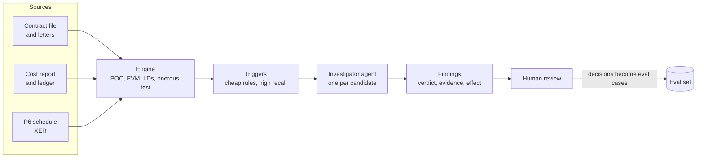

# Second Source

**Challenges the accounting on long-term fixed-price contracts by testing management's numbers against evidence finance doesn't control: the project schedule, the contract file and the customer's correspondence.**

For each contract it answers one question before the close: *is the reported margin supported by the evidence, and if not, by how much and what should we ask?* Every judgement gets one of four verdicts, every number comes from a deterministic engine, and every finding cites the document it rests on.

> **Status:** scaffold. The engine, simulator, triggers, rule baseline, eval harness, agent loop and MCP server run today. The headline result (agent vs one-prompt baseline) is next.

## Why

Long-term contract accounting fails in its inputs, not its arithmetic. Revenue is a share of the transaction price (TP), measured by cost progress, so nearly every misstatement either inflates TP (unagreed variations, optimistic claims) or deflates the estimated cost to complete (ETC). Those judgements are usually tested against management's own story. The evidence that contradicts them lives in other systems, chiefly the P6 schedule and customer correspondence.

When those judgements go wrong, the result is restatements, regulatory fines and, in the worst cases, corporate collapse.

## How it works



- **Engine** (`engine.py`): every number. POC, revenue, the onerous test, earned value, LDs, scenario re-runs.
- **Triggers** (`triggers.py`): raise candidate issues per check. A candidate is a question worth asking, not a finding.
- **Investigator** (`agent/`): one short-lived sub-agent per candidate, with tools to read and search documents, query the engine and run scenarios. It never supplies numbers: it proposes input overrides and the engine computes the effect. Quotes are verified against the cited document.
- **MCP server** (`mcp_server.py`): the read and scenario tools, so a controller can question a contract from Claude.

### Checks in v0

| ID | Question | Evidence it needs |
|---|---|---|
| T1 | Is each variation in TP agreed by the customer, or enforceable? (IFRS 15.18-21) | Variation register vs customer letters |
| E2 | Is management's ETC credible against earned value and physical progress? | P6 schedule, cost report, review minutes |
| M1 | If management's own EAC exceeds TP, is the full loss provided for? (IAS 37.66-69) | Engine output |

### Verdicts

| Verdict | Meaning | Output |
|---|---|---|
| supported | Evidence backs the treatment | Evidence links |
| misstated | Evidence shows it's wrong | Engine-computed correction |
| judgement_call | Evidence supports a range | Range and a question for a named role |
| insufficient_evidence | Can't tell from the file | The document that would settle it |

## Ground truth: the simulator

Real contract files are confidential, so the evals run on a simulator that generates fixed-price contracts with known truth: cost-loaded P6 schedules, a ledger, a cost report, the contract, variation submissions, customer letters and review minutes. Management's view is the truth plus at most one seeded issue. Labels are set in code, never by a model.

| Scenario | Expected verdict | What makes it hard |
|---|---|---|
| `t1_unaccepted` | misstated | Register says approved; the customer letter rejects or disowns it |
| `t1_in_principle` | judgement_call | Scope agreed, value disputed |
| `t1_no_evidence` | insufficient_evidence | Register says approved; no customer letter in the file |
| `e2_etc_understated` | misstated | Remaining work forecast at budget despite CPI well below 1 |
| `e2_recovery_plan` | judgement_call | ETC relies on savings a subcontractor hasn't agreed |
| `e2_one_off_overrun` | supported | EVM says optimistic, but the overrun was a documented one-off |
| `e2_hard_negative` | supported | Poor CPI, already reflected in ETC |
| `m1_no_provision` | misstated | Management's own EAC exceeds TP, no provision booked |

Plus approved, correctly booked variations on most contracts as natural false-positive traps, and customer letters that don't always use the contractor's reference format.

## Results so far (30 contracts, seed 0)

Offline systems only. `null` trusts management; `rules` is triggers plus deterministic verdicts, roughly what analytics without judgement can do.

| Metric | null | rules |
|---|---|---|
| Issues flagged (catch rate) | 0% | 64% |
| Share of misstated £ flagged | 0% | 86% |
| False alarms on clean items | 0% | 2% |
| Concluded when it should ask | 100% | 67% |
| Verdict accuracy | 79% | 87% |

The rules miss every variation problem the register hides (they trust it), conclude on every recovery plan, and raise false alarms on documented one-off overruns. Those are exactly the gaps the investigator agent has to close, and the one-prompt baseline (B0) is the bar it has to beat.

## Quickstart

```bash
uv sync                        # core: engine, simulator, rules, evals
uv run pytest
uv run second-source demo      # simulate 30 contracts, run null + rules, print the scorecard

# model-based systems
uv sync --extra agent
export ANTHROPIC_API_KEY=...
uv run second-source simulate --out data/dev
uv run second-source run --system agent --portfolio data/dev --limit 5
uv run second-source run --system one_prompt --portfolio data/dev --limit 5
uv run second-source eval --portfolio data/dev runs/agent.jsonl runs/one_prompt.jsonl

# MCP server
uv sync --extra mcp
SECOND_SOURCE_PORTFOLIO=data/dev uv run python -m second_source.mcp_server
```

Set `SECOND_SOURCE_MODEL` and `SECOND_SOURCE_B0_MODEL` to choose models.

## Layout

```
src/second_source/
  engine.py          deterministic accounting: POC, onerous test, EVM, LDs, scenarios
  xer.py             minimal P6 XER reader/writer and schedule metrics
  models.py          shared data shapes: terms, cost report, findings, labels
  store.py           loads a contract file (what a system may see)
  triggers.py        candidate issues per check
  systems.py         null and rules systems, system registry
  agent/             investigator agent, tools, guidance notes, one-prompt baseline, usage
  simulator/         portfolio generator with ground truth, document templates
  evals/score.py     verdict, catch, escalation and quantification metrics
  mcp_server.py      MCP tools over a portfolio
  cli.py             simulate | run | eval | demo
```

## Ground rules

Everything here is synthetic. Contractors, customers and projects are fictional, and nothing comes from any client engagement. Guidance notes paraphrase the standards and cite paragraph numbers rather than reproducing IFRS text.

## Roadmap

See [PLAN.md](PLAN.md).
